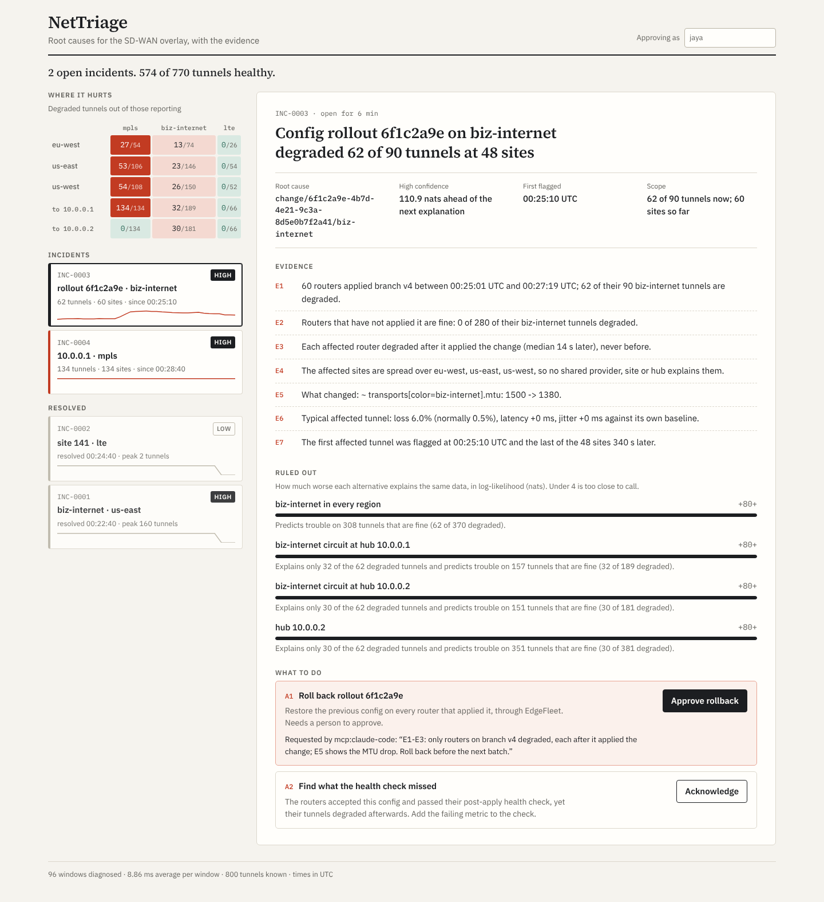

# NetTriage

Root-cause diagnosis for an SD-WAN overlay. When tunnels degrade, NetTriage finds the
smallest set of shared causes that explains which tunnels broke **and which didn't**:
a provider in one region, one site's circuit, a whole site, a hub, or a config rollout.
It records numbered evidence for every conclusion, proposes a fix, and exposes all of
it to AI agents over the Model Context Protocol. A person still approves anything that
touches the network.

It is the third piece of a small SD-WAN control-plane trio:

- **[WanPulse](https://github.com/JayaChandraDadi/wanpulse)** streams tunnel probes and
  publishes per-tunnel health every 10 s (gRPC, Kafka Streams).
- **[EdgeFleet](https://github.com/JayaChandraDadi/EdgeFleet)** onboards routers and
  rolls config out in health-gated batches.
- **NetTriage** reads both: WanPulse's `tunnel.health` topic for what the network is
  doing, EdgeFleet's event log for what was changed. It answers why.



More views: [a resolved LTE circuit outage](docs/dashboard-circuit.png), [phone](docs/dashboard-mobile.png), [dark](docs/dashboard-dark.png). All from `scripts/demo.sh`, a replayed simulation.

## Why this is hard

A provider brownout in one region turns a few hundred tunnels red at once. Per-tunnel
alerting pages hundreds of times. Grouping by "most common attribute" blames the
biggest bucket: the hub, or the whole carrier. Blaming the latest change is wrong
whenever a rollout happens to coincide with an outage. And a subtle brownout (1% loss,
+15 ms) trips a per-tunnel detector on only some of the affected tunnels, so any rule
that waits for 80% of a provider's tunnels to go red never fires.

The evidence that separates these cases is the **healthy** tunnels. If every
biz-internet tunnel in us-west is degraded but biz-internet in us-east is fine, and
MPLS in us-west is fine, the cause is the biz-internet provider in us-west: not the
carrier, not the sites, not a hub.

## How it works

**1. Each tunnel against its own normal.** Per tunnel, an exponentially weighted
baseline of latency, jitter and probe loss, learned only from healthy windows so a long
fault can't become the new normal. A window is degraded when loss is statistically above
the baseline expectation, or latency or jitter rises by more than four standard
deviations (with floors of 20 ms and 10 ms). A tunnel counts as degraded only when two
of its last three windows were, and as healthy only when none were; anything in between
stays out of the math rather than counting either way.

**2. The smallest explanation (the localizer).** Every observed tunnel is degraded or
healthy. Each candidate cause covers the tunnels that depend on it. The model is a
noisy-OR:

```
P(tunnel degraded) = 1 - (1 - eps) * prod over failed causes c covering it of (1 - p_c)
```

where `eps` is the background rate of unexplained degradation and `p_c` is the share of
its tunnels a cause degrades, estimated from the data. A hypothesis is scored by the
log-likelihood of every observation minus a cost per cause, and the search adds causes
greedily, then prunes any made redundant. Details that each fixed a measured failure:

| Design choice | Failure it fixed |
|---|---|
| `p_c` is estimated, not assumed to be 1 | A subtle brownout trips the detector on 55% of the provider's tunnels; this is still overwhelming evidence against 200 unrelated failures. |
| **Partial pooling per transport** for causes spanning several (`p_t = (hits_t + 20 p) / (observed_t + 20)`) | LTE's noisy baseline hid part of a hub fault, and "the hub's MPLS circuit plus its internet circuit" fit better than "the hub". |
| Cost per cause is a **description length**, `lambda + ln(N_kind)` | Two random blips on the same site looked like a site failure. Naming one of 200 sites costs more evidence than naming one of 2 hubs: a multiple-comparisons correction. |
| A new cause must degrade at least 10% of its tunnels | A hub "degrading 2% of its tunnels" explained scattered noise better than noise did. |
| Causes already open as incidents pay a lower cost and floor | Subtle faults hovering at the detection threshold flickered between open and resolved. |
| That discount can pass to **one** re-wording that still explains 80% of the open cause's tunnels | A site incident could never sharpen to the LTE circuit that was really down. Granting the discount to every nested element instead split hub faults into circuits, and pinned leftover blips on cheap circuits. |
| **Symptoms are evidence**: each cause has a blackout share, scored against each degraded tunnel's symptom | An LTE circuit died at a site whose internet tunnels were already slow from a regional brownout. Degraded or healthy alone could not tell "site down" from "LTE circuit down"; the symptoms can. |
| `eps` is re-estimated from unexplained degradation | On a noisier network the fixed rate was too low and noise was blamed on sites. |

`lambda` and the `eps` floor were tuned on a separate set of seeds
([tuning-sweep.json](docs/tuning-sweep.json)); the results below are on seeds the
design never saw.

**3. Config changes are candidates too.** For each EdgeFleet rollout, NetTriage fetches
every router's config before and after, diffs it, and works out which transport it
touched (`transports[color=biz-internet].mtu: 1500 -> 1400` touches only
biz-internet). The rollout then covers those routers' tunnels on that transport, *as
of each router's own apply time*. A rollout is dropped as a suspect when its tunnels
were degraded before their router applied it, because a cause can't come after its
effect.

**4. Incidents with a lifetime.** A cause opens an incident at once when confidence is
high, otherwise after it persists for two windows. When the explanation sharpens (one
circuit at a site, then the whole site), the incident keeps its id and records the
change. It resolves after 30 s without its cause.

**5. Evidence, alternatives, confidence.** Each cause gets plain sentences, numbered
E1, E2..., built from contrasts: what is broken, what is not and which alternative that
rules out, the signature (blackout, loss, latency, jitter), timing, and, for any rollout
that touched the affected routers, why it does or doesn't fit. Confidence is the
log-likelihood margin over the best competing explanation of the same tunnels: HIGH at
10 nats or more, MEDIUM from 4, LOW below.

## Measured

### Benchmark: 600 faults with known causes

A simulated 200-site fleet (800 tunnels) uses WanPulse's noise model: mean-reverting
latency, per-probe loss, and transport profiles for MPLS, business internet and LTE.
There are 16 scenario types, each run 40 times on unseen seeds. Every run carries
background noise: random single tunnels dropping a third of their probes for 10 to 20 s.
Every method is judged on the same degraded and healthy tunnel states, 90 s after the
fault starts ([raw results](docs/bench-results.json)).

| Scenario | NetTriage | Threshold set cover (80% / 50%) | Alarms only | Blame latest change |
|---|---|---|---|---|
| Provider brownout | **100%** | 100% / 100% | 67.5% | 100% |
| Subtle brownout (0.8–2% loss, +10–25 ms) | **60%** | 15% / 17.5% | 40% | 15% |
| Brownout with 10× background noise | **100%** | 97.5% / 85% | 0% | 97.5% |
| Jitter storm | **100%** | 100% / 100% | 92.5% | 100% |
| Carrier-wide outage | **100%** | 100% / 92.5% | 90% | 100% |
| One circuit down | **100%** | 100% / 100% | 47.5% | 100% |
| One circuit degraded | **100%** | 100% / 100% | 57.5% | 100% |
| Whole site down | **100%** | 100% / 100% | 80% | 100% |
| Hub degraded | **100%** | 100% / 95% | 92.5% | 100% |
| One hub circuit degraded | **100%** | 97.5% / 85% | 60% | 97.5% |
| Bad config rollout (caught at the canary) | **100%** | 92.5% / 100% | 62.5% | 100% |
| Harmless rollout coinciding with a brownout | **100%** | 100% / 100% | 77.5% | **0%** |
| Two unrelated faults at once | **100%** | 97.5% / 97.5% | 40% | 97.5% |
| A circuit dies inside a brownout on its site's other transport | **100%** | 100% / 100% | 42.5% | 100% |
| **All 560 fault runs** | **97.1%** | 92.9% / 90.9% | 60.7% | 86.3% |
| Harmless rollout, no fault | 100% | 100% / 100% | 80% | 90% |
| Noise only | 100% | 100% / 100% | 80% | 100% |

- **Exact root cause:** the method names exactly the injected cause, nothing more and
  nothing less.
- **Threshold set cover:** a shared-risk localization baseline in the spirit of SCORE.
  It only blames elements with at least 80% (or 50%) of their tunnels degraded.
- **Alarms only:** repeatedly blames whatever covers the most degraded tunnels, without
  looking at healthy ones.
- **Blame latest change:** blames the most recent rollout that touched an affected
  router, which is what a tired on-call engineer does first.

What else the runs show:

- **Speed.** Time from fault start to the right incident: median 17.5 s, 90th percentile
  29.5 s, with 10 s windows. (In the overlapping-outage runs the circuit dies a minute
  after the brownout starts, and is named about 20 s after it dies.) Incidents resolved a
  median 46.5 s after the fault ended.
- **False incidents.** 17 in 640 runs, about 100 fleet-hours: roughly one every 6 hours
  for a 200-site fleet. All but one were LOW confidence, mostly 2-tunnel coincidences.
- **Where it is weak:**
  - Subtle brownouts. 60% are named correctly at the 90 s mark, and 9 of the 40 were
    never diagnosed at all. They are barely visible per tunnel. On the development seeds
    this type scored 90%, so the 60% here is the honest number.
  - Single-circuit faults. They are always found, but only at LOW confidence. Two tunnels
    give about 12 nats of evidence per window, against about 10 nats to name one of 400
    circuits.
- **Alert volume.** A per-tunnel SLA alert rule raised 241,172 alerts across the fault
  runs (voice class: loss over 1%, latency over 150 ms or jitter over 30 ms, for two
  windows). NetTriage opened 646 incidents for the same runs.
- **Cost.** Diagnosis time per 10 s window on one core: 0.9 ms for 800 tunnels, 8 ms
  for 4,000, 45 ms for 10,000, 179 ms for 20,000.

### Live with EdgeFleet: from rollout to approved rollback

`scripts/live-edgefleet.sh` runs the real EdgeFleet controller and 40 simulated routers
([raw results](docs/live-edgefleet.json)):

1. EdgeFleet rolls a change out to a pilot group of 10 routers, every fourth one, so
   they are spread over sites and regions. The change sets the internet MTU to 1400.
   Every router applies it and passes its own post-apply health check.
2. NetTriage, following EdgeFleet's event log, recorded the rollout with its diff
   (`~ transports[color=biz-internet].mtu: 1500 -> 1400`) and worked out that only
   biz-internet was touched.
3. Telemetry then shows the pilot routers' internet tunnels losing 5% of probes, each
   from its own apply time. NetTriage opened one incident with the rollout as the root
   cause, at HIGH confidence and a margin of 41.9 nats:
   - E1: 10 routers applied branch v2 within 2 s; 18 of their 18 biz-internet tunnels
     are degraded.
   - E2: routers that have not applied it are fine (0 of 60).
   - E3: each affected router degraded after it applied the change (median 11 s), never
     before.
   - E4: the sites are spread over three regions, so no shared provider, site or hub
     explains them.
4. Approving the proposed rollback in NetTriage (as "jaya") called EdgeFleet, which
   rolled the deployment back. The pilot routers ended on version 3: a new version
   carrying the old config.

### Live with WanPulse: six faults through the real pipeline

`scripts/live-wanpulse.sh` runs the real WanPulse pipeline: 500 simulated edges stream
probes over gRPC, Kafka Streams windows them, and NetTriage consumes `tunnel.health`.
Six scripted faults are scored against the simulator's ground-truth log, in wall-clock
time.

**First run** ([raw results](docs/live-wanpulse-run1.json)):

| Fault | Expected root cause | Named | Time to diagnose |
|---|---|---|---|
| Internet brownout in us-west | `provider/biz-internet/us-west` | yes | 24.6 s |
| LTE outage at site 102, during that brownout | `site/102/lte` | **no** (blamed `site/102`) | – |
| LTE jitter storm in us-east | `provider/lte/us-east` | yes | 25.9 s |
| Hub 10.0.0.2 degraded | `hub/10.0.0.2` | yes | 25.5 s |
| Site 117 down | `site/117` | yes, but as a relabel of the hub incident | 25.2 s |
| MPLS brownout in eu-west | `provider/mpls/eu-west` | yes | 25.8 s |

The 25 s diagnosis time includes WanPulse's 10 s windows, its 5 s grace period and
Kafka. Over the run, WanPulse raised 4,624 per-tunnel SLA alerts; NetTriage opened 5
incidents.

**What the run exposed, now fixed:**

1. **The site-102 LTE outage.** All four of site 102's tunnels were red: the LTE pair from
   the outage, the internet pair from the brownout. On degraded-or-healthy alone, "site
   102 is down" was as good an explanation as "its LTE circuit is down". Once the site
   incident was open, the cheaper cost for open causes also stopped it from ever
   sharpening. Fixed by making symptoms evidence: blackout against slowdown. Also, one
   re-wording of an open cause can now take over its discount.
2. **The site-117 outage.** It started while the hub incident was fading, and two of its
   tunnels end at that hub. The incident matcher compared overlap against the smaller set
   of degraded tunnels, so it relabelled the hub incident instead of opening a new one.
   Fixed by requiring most of both sets to overlap.

Both cases are now regression tests, and the benchmark has an overlapping-outage
scenario. A re-run of the live test on the fixed build is in progress.

## The AI interface

NetTriage serves seven tools over MCP (streamable HTTP at `/mcp`):

| Tool | |
|---|---|
| `fleet_overview` | Degradation by region and transport, open incidents, engine status |
| `list_incidents` | Root cause, confidence, scope |
| `get_incident` | Headline, evidence E1..En, ruled-out alternatives with reasons, signature, timeline, proposed actions |
| `query_tunnels` | Raw per-tunnel numbers against each tunnel's baseline |
| `compare_hypotheses` | Tests any alternative against the root cause on the latest data, with the likelihood margin |
| `list_config_changes` | Recent EdgeFleet rollouts, their diffs, how many touched tunnels are degraded |
| `request_remediation` | Files a request for a person to approve. **Changes nothing.** |

The first six are annotated read-only. To connect Claude Code:

```bash
claude mcp add --transport http nettriage http://localhost:8095/mcp
```

The design keeps the statistics out of the model. The engine does the localization,
which is deterministic, testable and benchmarked above. The model's job is to check it,
test alternatives, explain it in plain words and decide what to propose, and every one
of its claims has to trace back to a tool result.

**The built-in agent** (`agent/`) is a Claude tool-use loop over the same tools. It
finishes by calling `submit_diagnosis` once per incident. A grounding verifier then
rejects any diagnosis that:

- cites an evidence id the incident doesn't have;
- names a root cause the engine never considered, without saying it disagrees; or
- states a number that appears in no tool result.

The test suite drives the whole loop against a scripted stand-in for the Messages API.
It covers the request format, tool errors returned with `is_error`, a fabricated `E99`
and an invented number both caught, and remediation requests filed but never executed.
`AgentEval` scores a real model on benchmark scenarios with known causes:

```bash
ANTHROPIC_API_KEY=... java -jar agent/target/agent-0.1.0-exec.jar --per-type 2   # model: NETTRIAGE_AGENT_MODEL
```

I have not run it against a real model yet (no API key in the environment where this
was built), so there is no agent accuracy number here.

## Run it

Java 21 and Maven; Node 22 for the dashboard.

```bash
mvn -q install                       # builds and runs all tests
java -jar bench/target/bench-0.1.0-exec.jar --per-type 40 --seed 5001 --scale   # the benchmark above, about a minute
scripts/demo.sh && (cd dashboard && npm install && npm run dev)                  # the screenshots above, http://localhost:5175
```

Against the other two projects (cloned next to this one and built):

```bash
scripts/live-wanpulse.sh             # WanPulse + six scripted faults, scored; about 17 min
scripts/live-edgefleet.sh            # EdgeFleet rollout -> diagnosis -> approved rollback; about 3 min
```

The service on its own:

```bash
KAFKA_ENABLED=true KAFKA_BOOTSTRAP=localhost:9092 EDGEFLEET_URL=http://localhost:8090 \
  java -jar service/target/service-0.1.0.jar        # REST and MCP on :8095
cd dashboard && npm install && npm run dev           # http://localhost:5175
```

With `REPLAY_ENABLED=true` (the default), `POST /api/replay/window` and
`POST /api/replay/changes` accept telemetry and changes over HTTP instead, for demos and
tests.

**Tests** (`mvn verify`, 31):

- Detector, localizer and incident-tracker unit tests, including the two failures the
  live run found.
- Whole-engine scenario tests: evidence content, the rollback proposal, the rollout that
  coincides with a brownout being cleared, incident resolution, telemetry gaps skipped.
- The agent loop and grounding checks.
- A Spring Boot integration test that replays a rollout over HTTP and inspects it through
  REST and through a real MCP client (the official Java SDK). It also checks that
  approval needs a named person.

## REST API

| Endpoint | |
|---|---|
| `GET /api/status` | Engine, ingest, Kafka and EdgeFleet status |
| `GET /api/grid` | Degraded tunnels by region and transport, and by hub |
| `GET /api/incidents?all=`, `GET /api/incidents/{id}` | Incidents with evidence, alternatives, actions |
| `GET /api/incidents/{id}/compare?element=` | Root cause against any alternative |
| `GET /api/tunnels?site=&color=&region=&hub=&degraded=` | Per-tunnel measurements and baselines |
| `GET /api/changes` | Rollouts as NetTriage sees them |
| `POST /api/incidents/{id}/actions/{actionId}/approve` | Approve an action as a named person; a rollback is sent to EdgeFleet |
| `POST /api/actions/{requestId}/approve`, `/reject` | Decide a request an agent filed |
| `GET /api/actions` | Every request and decision, with who and why |

## Layout

| Module | |
|---|---|
| `triage-core` | Detector, localizer, incidents, evidence, the tool layer. No framework dependencies. |
| `bench` | Simulated fleet, 15 fault scenarios, three baselines, scoring |
| `agent` | Claude tool-use agent, grounding verifier, evaluation harness |
| `service` | Spring Boot: Kafka consumer, EdgeFleet follower, REST, MCP server, approvals |
| `dashboard` | React case-file view |
| `scripts`, `tools` | Live runs against WanPulse and EdgeFleet, and their scoring |

## Limits

- **Evidence is per window.** A two-tunnel circuit outage gives the same evidence in its
  tenth minute as in its first, so it never rises above LOW confidence. The next step is
  to accumulate evidence over time: a fault that persists is much less likely to be
  noise.
- **All the accuracy numbers come from simulated faults.** The simulator follows
  WanPulse's noise model, which is plausible but not measured from a real network.
- **Only the branch side reports.** A router that goes silent is treated as unknown, not
  as down. Real BFD data from the hub side would close that gap; EdgeFleet's
  control-session status is used as corroboration meanwhile.
- **Baselines never re-learn a permanent shift**, such as a new, longer path. That would
  stay an incident until someone acts.
- **Approvals carry a name but no authentication.**
- **The Docker Compose file has not been run**, because there was no Docker where this
  was built. Everything else above was run.
